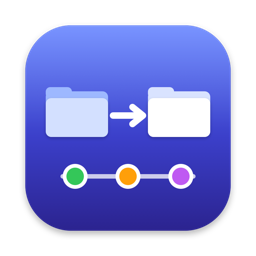

<p align="center"></p>

# FolderSync

A native macOS app for **one-way folder synchronization** with configurable deletion handling,
an encrypted local version history, and a Git-style visual commit graph. It is private by
construction: it makes no network connections, sends no telemetry, and never interprets file contents.

* Architecture, security model, graph semantics and data-loss mitigations: [docs/ARCHITECTURE.md](docs/ARCHITECTURE.md)
* Which test verifies which requirement, plus what is not yet verified: [docs/VERIFICATION.md](docs/VERIFICATION.md)

## Install

1. Download the latest **FolderSync-x.y.z.dmg** from [Releases](https://github.com/JPGeszti/filesync/releases/latest).
2. Open it and drag **FolderSync** onto **Applications**.
3. Open FolderSync from Applications or Launchpad. It also lives in the **menu bar**, where you can see
   sync status, sync a pair and pause, even after closing the window.

FolderSync is not notarized by Apple (that requires a paid Apple Developer account), so the first time you
open a downloaded copy macOS says it cannot verify the app. Click **Done**, then open
**System Settings → Privacy & Security** and click **Open Anyway** next to the FolderSync message.

The first time FolderSync starts, it creates an encryption key in your Keychain. After installing a new version,
macOS may ask once whether FolderSync may use that key. Choose **Always Allow**.

Requires macOS 14 or later; the app is universal (Apple silicon and Intel).

## Build & run

Requires macOS 14+ and Swift 6 (the Command Line Tools are enough; Xcode is optional).

```bash
scripts/test.sh                 # 82 automated tests on synthetic data in the temp directory
scripts/build-app.sh            # → build/FolderSync.app (universal, sandboxed, ad-hoc signed)
scripts/make-dmg.sh             # → build/FolderSync-<version>.dmg and .zip, plus SHA256SUMS.txt
```

With Xcode installed you can also generate a project: `brew install xcodegen && xcodegen generate`.

`scripts/make-icon.sh` regenerates the app icon (`Resources/AppIcon.icns`) from `scripts/make-icon.swift`.

### Publishing a release

Every push and pull request runs the tests on GitHub Actions. To publish a downloadable version, tag it:

```bash
git tag v1.0.0
git push origin v1.0.0
```

The workflow builds the universal app, packages the DMG and zip, and attaches them to a new GitHub Release.

### Development helpers

* `FOLDERSYNC_STORAGE_ROOT=<dir>` keeps the database and version store somewhere other than Application Support.
* `FOLDERSYNC_SEED_DEMO=<empty dir> scripts/test.sh --filter DemoSeeder` creates a synthetic demo history.
* `FOLDERSYNC_UI_SNAPSHOT_DIR=<dir>` makes an unsandboxed debug build render every section to a PNG and quit.

## Layout

```
Sources/FolderSyncCore   engine: scanner, planner, executor, recovery, encrypted object store, SQLite catalog
Sources/FolderSyncApp    SwiftUI app: dashboard, pairs, changes, commit graph, archives, activity, settings
Tests/FolderSyncCoreTests Swift Testing suites (sync, deletion policies, security, crash recovery, privacy…)
Resources/               Info.plist, entitlements (sandbox, user-selected folders, bookmarks — no network)
```

## Toolchain notes

* `scripts/test.sh` passes the Swift Testing macro plugin path explicitly. Without it, some Command Line Tools
  builds fail at random with "plugin for module 'TestingMacros' not found".
* The app uses `ViewState` (a typealias for SwiftUI's `State` property wrapper) instead of `@State`, because
  recent SDKs implement `@State` as a macro whose plugin ships only with Xcode.
